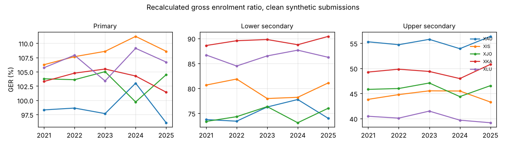

# edupipe: automating multi-year Excel survey templates

[](https://github.com/eliekayitare/edu-template-pipeline/actions/workflows/ci.yml)

Many statistical offices collect data from countries, regions or institutions through **Excel
templates**: workbooks with input cells, built-in formulas, validation rules and several years of data
side by side. Every cycle, someone has to roll the template forward a year, produce language versions,
and then check, recalculate and consolidate the submitted files.

`edupipe` automates that whole cycle in Python, using a synthetic education survey as the example:

| Step | What it does | Module |
|---|---|---|
| **Build** | Creates the blank template: input cells (yellow), formulas (green), data validation | `template.py` |
| **Add a year** | Rolls the template forward: new year column, formulas shifted, styles and validation extended | `update.py` |
| **Translate** | Generates FR / ES / PT / RU versions from one string table; renames sheets and rewrites formulas to match; reports untranslated strings | `translate.py` |
| **Extract** | Reads a folder of submitted workbooks into one tidy long table, keeping the cell address of every value | `extract.py` |
| **Validate** | Applies rules defined in YAML: metadata, non-negative values, sex totals, age totals, year-on-year change, age-cohort consistency, indicator range, indicator recalculation | `validate.py` |
| **Recalculate** | Recomputes indicators (gross enrolment ratio) independently and compares them with the reported values | `indicators.py` |
| **Report** | Per-country QC workbook (checklist and issues with cell references), per-country review report (HTML with table and chart), cross-country summary, consolidated CSVs | `report.py` |

> **All data in this repository is synthetic.** Countries are fictional (codes start with `X`).
> The template is a simplified demonstration and is **not** an official instrument of UNESCO,
> the UNESCO Institute for Statistics or any other organization.

## Quick start

```bash
git clone https://github.com/eliekayitare/edu-template-pipeline.git
cd edu-template-pipeline
pip install -e .[dev]

python -m edupipe demo     # build -> add year -> translate -> simulate 12 submissions -> validate
pytest -q                  # 14 tests
```

`demo` writes:

```
templates/   template_en.xlsx, template_en_next_year.xlsx, template_next_year_{fr,es,pt,ru}.xlsx
data/        12 synthetic country submissions (7 with deliberately injected errors)
output/      index.html                      cross-country QC summary
             reports/<ISO>_review.html       country indicator review report
             qc/<ISO>_qc.xlsx                checklist + issues, each pointing to a cell
             consolidated_long.csv           every value from every submission, with QC status
             consolidated_indicators.csv     reported vs recalculated indicators
             qc_summary.xlsx, qc_issues_all.csv
```

A copy of these outputs is committed in [`examples/`](examples/) so you can look without running anything.

Individual commands:

```bash
python -m edupipe build --out templates/template_en.xlsx
python -m edupipe add-year templates/template_en.xlsx templates/next.xlsx --version 2027.1
python -m edupipe translate templates/next.xlsx --outdir templates
python -m edupipe simulate --outdir data/submissions --n 12
python -m edupipe run --indir data/submissions --outdir output
```

Optional point-and-click front end for non-programmers:

```bash
pip install -e .[app]
streamlit run app/streamlit_app.py
```

## What the validation finds

The simulator injects one realistic problem into seven of the twelve submissions. The pipeline finds
all of them and raises nothing on the five clean files (this is tested):

| Country | Injected problem | Rule raised |
|---|---|---|
| XBR | Lower-secondary total ≠ Female + Male | `SEX_SUM` (error) |
| XCA | Contact email missing | `META_REQUIRED` (error) |
| XDE | Single-age enrolment does not add up to the primary total | `AGE_SUM` (error) |
| XEV | Upper-secondary enrolment jumps 56% in one year | `YOY_CHANGE` (warning) |
| XFA | Decimal-point slip in a reported GER (1075.0 instead of 107.5) | `GER_RECALC` (error), `GER_RANGE` (warning) |
| XGR | Negative population value | `NON_NEGATIVE`, `SEX_SUM` (errors), `GER_RANGE` (warning) |
| XHE | Pupils moved between ages: totals still match, cohorts do not | `AGE_COHORT` (warnings) |

Each issue records the rule, severity, the exact cell (for example `Indicators!H6`), the value found,
the value expected and a plain-language message that can be sent back to the country.



## Design choices

- **Rules are data, not code.** Thresholds and checks live in
  [`config/validation_rules.yaml`](config/validation_rules.yaml); the template layout lives in
  [`config/template_spec.yaml`](config/template_spec.yaml); translations live in
  [`config/translations.csv`](config/translations.csv). A non-programmer can change a tolerance or add a
  translation without touching Python. Adding a new kind of check means writing one small function
  decorated with `@check("rule_type")`.
- **Locate by label, not by position.** Extraction finds year columns from the header row and rows from
  their labels, so small layout changes between template versions do not break it.
- **One master, many languages.** Language versions are generated from the English master, so cells,
  formulas and validation are identical in every language. Sheet renames are carried into formulas
  (`=Enrolment!C4` becomes `='Effectifs'!C4`), and any string without a translation is reported.
- **Independent recalculation.** Indicators are recomputed from the raw enrolment and population data
  and compared with what the workbook reports, which catches broken formulas and manual edits.
- **Reproducible.** Seeded simulation, pinned dependencies in `pyproject.toml`, tests and an end-to-end
  demo run on every push (GitHub Actions, Python 3.10 and 3.12).

## Layout

```
config/            template spec, validation rules, translation table
src/edupipe/       template, update, translate, simulate, extract, validate, indicators, report, pipeline, cli
tests/             pytest suite (template update, translation, validation, pipeline)
app/               Streamlit front end
examples/          committed copy of generated templates, sample submissions and outputs
```

## Limitations and next steps

- Submissions are read with `openpyxl` using stored cell values. Files saved by Excel contain cached
  formula results; for files that were never opened in Excel, recalculate first (for example with
  LibreOffice headless) or rely on the independent recalculation, as this pipeline does.
- The example covers one indicator family (gross enrolment ratio). More indicators, such as out-of-school
  rates, completion rates and expenditure ratios, plug into `indicators.py` and `validation_rules.yaml`
  the same way.
- Translations of the demonstration strings were prepared for this example and should be reviewed by
  native speakers before any real use.

## License

MIT © Elie Kayitare Uwiringiyimana
